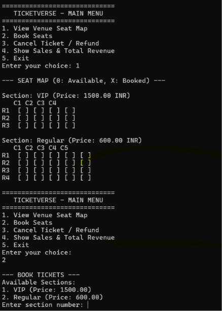

# TicketVerse

A command-line ticket booking system written in C.

## Features
- View the venue seat map
- Book seats
- Cancel tickets and get refunds
- Show total sales and revenue

## How to compile and run
gcc yourfilename.c -o ticketverse
./ticketverse

(On Windows: ticketverse.exe)

## Screenshot

